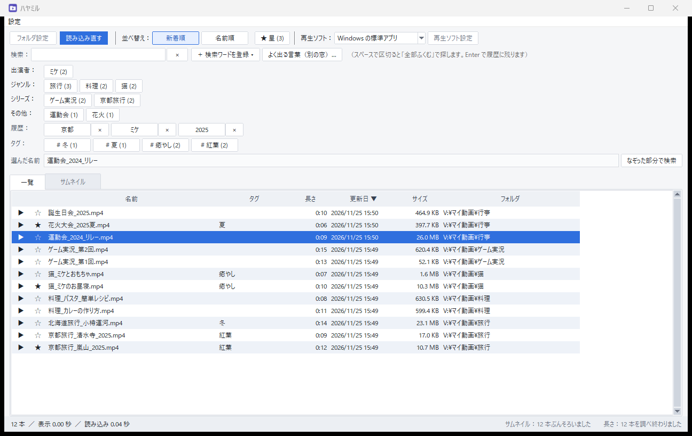
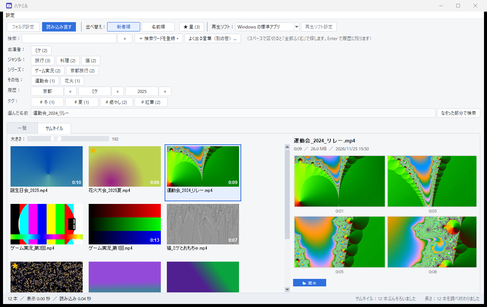

# ハヤミル

登録したフォルダの動画を一覧にして、すぐ並べ替え・検索・再生できる Windows 向けのアプリです。動画が何千本あっても、軽く動くことを一番の目標にしました。



## できること
- **一覧と並べ替え**：登録したフォルダ（中のフォルダも含む）の動画を集めて、新着順・名前順にすぐ並べ替えます。列はドラッグで入れ替えられ、境目のダブルクリックで幅を合わせます
- **検索**：打つたびに絞り込みます。名前・フォルダ名・タグが対象で、スペースで区切ると「全部ふくむ」で探します
  - 大文字と小文字、全角と半角の違いはそろえて比べます
  - 一覧で選んだ動画の名前を右クリックするか、なぞるだけでも検索できます（キーボードを打たなくてよい）
- **検索ワードのボタン**：よく使う言葉を「出演者・ジャンル・シリーズ」などの分類ごとにボタンにして、1回押すだけで検索できます。ボタンには本数も出ます
- **よく出る言葉**：ファイル名によく出てくる言葉を多い順に並べ、ボタン1回で分類に入れられます
- **タグと星**：動画にタグを付けたり、特に好きな動画に星を付けたりして、すぐ呼び出せます
- **再生**：一覧の左端の ▶ を1回押すと再生します。使う再生ソフトは登録して切りかえられます
- **長さ・サムネイル**：動画の長さとサムネイル（小さな見本の絵）を裏で少しずつ作り、保存しておきます。サムネイルの大きさはスライダーで変えられます
- **設定の保存・読み込み**：検索ワード・フォルダ・タグなどを1つのファイルにまとめて保存し、別のパソコンへ移せます



## 工夫したところ
- **一覧をすぐ出す**：フォルダの中身は `os.scandir`（中身をまとめて読む仕組み）で読み、別のスレッド（裏で同時に動く処理）で動かして画面を固めません。試験用の5,000本で、読み込み0.08秒、並べ替え0.1秒前後でした
- **重い仕事は裏で少しずつ**：長さとサムネイルは一覧を出したあとに裏で作り、見えている動画を先に作ります。結果は保存し、動画が書きかわったときだけ作り直します
- **見えている所だけ描く**：サムネイルは画面に見えている分だけを描くので、何千本あってもスクロールが重くなりません
- **使いながら直した**：実際に使って出た「遅い」「手間」という声を、毎回時間を測って直しました。たとえば「よく出る言葉」の窓は、ボタンを部品ではなく絵として描く方式にして、約5秒の待ち時間を約0.1秒にしました
- **見た目と軽さの両立**：追加の部品は使わず、tkinter に元からある見た目（clam）の色と余白を整えました。前後で速さを測り、遅くならないことを確かめました

## 使い方
### 必要なもの
- Windows
- Python 3（3.13 で確かめました）
- Pillow（画像を扱う部品）
- [ffmpeg](https://ffmpeg.org/)（動画を扱う道具。`ffmpeg` と `ffprobe` が使える状態にしておきます。無くても一覧・検索・再生は使えますが、長さとサムネイルは出ません）

```
pip install -r requirements.txt
```

### 起動

```
python video_browser.py
```

1. 「フォルダ設定」で、動画が入っているフォルダを登録します
2. 一覧が出たら、並べ替え・検索・▶ で再生します
3. 動画が増えたときは「読み込み直す」を押します

設定・タグ・サムネイルは、アプリと同じフォルダに保存されます。

### exe にする（Windows）
[PyInstaller](https://pyinstaller.org/) を使うと、ダブルクリックで開ける exe にできます。exe の中に ffmpeg は入らないので、使うパソコンに ffmpeg が必要です。

```
pip install pyinstaller
python -m PyInstaller --noconfirm hayamiru.spec
```

`dist` フォルダに `hayamiru.exe` ができます。

## ファイル
- `video_browser.py`：アプリ本体（作り始めたときの名前「動画ブラウザ」のままにしています）
- `hayamiru.spec`：exe にするときの設定
- `make_icon.py`：アイコン（`icon.ico`）を作るスクリプト
- `requirements.txt`：必要な Python の部品
- `images/`：README の画面写真（試験用の動画で撮ったもの）

## 使ったもの
- Python、tkinter、Pillow、ffmpeg、PyInstaller
- Claude：1ステップずつ一緒に作り、毎回動かして確かめました
